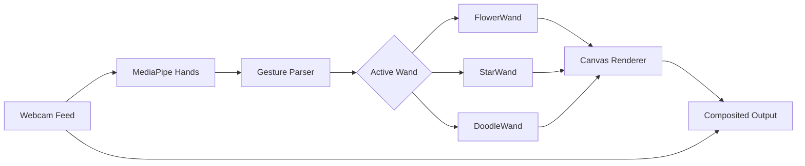

Point your index finger at the screen and a flower blooms. Make a fist, then open your palm, and a constellation explodes into a shower of wishes. No mouse, no touchscreen — just a webcam and your hand.
 
That's **Magical Wands**: a real-time, gesture-controlled creative canvas built with Next.js, Google's MediaPipe Hands, and the HTML5 Canvas API, running entirely in the browser at 60 FPS.
 
This post is a full walkthrough of how it's built — hand tracking, gesture recognition, the wand system, the sprite engine that keeps 600+ flowers rendering smoothly — and how to take it from `git clone` to a live production deployment.
 
<br />
## What we're building
 
Three "wands," one canvas, one webcam:
 
- 🌸 **Flower Wand** — point your index finger to plant one of 20 procedurally-drawn flower species along your fingertip's trail
- ⭐ **Star Wand** — point to place stars, make a fist to charge a constellation, open your palm to release a "make a wish" burst
- ✏️ **Doodle Wand** — pinch your thumb and index finger to draw freehand neon light trails in mid-air
Plus a photo/video capture mode that composites your webcam feed with whatever you've drawn, and a full mouse/touch fallback for anyone without a camera.
 
## Prerequisites
 
- Node.js 18+
- Familiarity with React and the Next.js App Router
- A browser with webcam access (Chrome, Edge, or Firefox all work well)
You don't need prior experience with computer vision — MediaPipe does the heavy lifting, and we'll build the gesture logic on top of it from scratch.
 
<br />
## Part 1 — Project setup
 
Scaffold a fresh Next.js app with the App Router:
 
```bash
npx create-next-app@latest magical-wands
cd magical-wands
```
 
When prompted, App Router: yes, Tailwind: your call (Magical Wands uses hand-rolled CSS for its "Minimal Vintage" HUD aesthetic, but Tailwind works fine too).
 
Install the one real dependency this whole project rests on — MediaPipe Hands:
 
```bash
npm install @mediapipe/hands @mediapipe/camera_utils @mediapipe/drawing_utils
```
 
Everything else — the sprite engine, the wand physics, the recording pipeline — is plain Canvas2D and browser APIs. No animation library, no WebGL. That's a deliberate choice: keeping the render path to raw `CanvasRenderingContext2D` calls is what makes 600 simultaneous flowers at 60 FPS realistic on mid-range laptops.
 
## Part 2 — The architecture
 
Here's the shape of the finished app:
 
```
src/
├── app/
│   ├── globals.css       # design system
│   ├── layout.js         # root layout, fonts
│   └── page.js           # renders <MagicalCanvas />
├── components/
│   └── MagicalCanvas.js  # landing screen + camera HUD
└── lib/
    ├── app.js            # MagicalApp controller (lifecycle, render loop)
    ├── handTracking.js   # MediaPipe wrapper + mouse/touch fallback
    ├── artAssets.js       # sprite engine — flowers, stars, lines
    ├── gallery.js          # photo & video capture
    └── wands/
        ├── flowerWand.js
        ├── starWand.js
        └── doodleWand.js
```
 
And the data flow, frame by frame:
 

 
Every frame: MediaPipe hands us 21 hand landmarks → we classify a gesture from those landmarks → the currently active wand decides what to do with that gesture → the wand draws to a full-screen canvas → we composite that canvas over the raw webcam feed.
 
Let's build each piece.
 
<br />
## Part 3 — Hand tracking with MediaPipe
 
The core wrapper lives in `lib/handTracking.js`. It initializes MediaPipe Hands in its lightest configuration, since inference speed matters more here than landmark precision:
 
```js
// lib/handTracking.js
import { Hands } from "@mediapipe/hands";
import { Camera } from "@mediapipe/camera_utils";
 
export class HandTracker {
  constructor(videoEl, onResults) {
    this.hands = new Hands({
      locateFile: (file) =>
        `https://cdn.jsdelivr.net/npm/@mediapipe/hands/${file}`,
    });
 
    this.hands.setOptions({
      maxNumHands: 1,
      modelComplexity: 0,       // Lite model — fastest inference tier
      minDetectionConfidence: 0.7,
      minTrackingConfidence: 0.6,
    });
 
    this.hands.onResults(onResults);
    this.videoEl = videoEl;
  }
 
  async startCamera() {
    try {
      this.camera = new Camera(this.videoEl, {
        onFrame: async () => {
          if (!this.isProcessingFrame) {
            this.isProcessingFrame = true;
            await this.hands.send({ image: this.videoEl });
            this.isProcessingFrame = false;
          }
        },
        width: 640,
        height: 480,
      });
      await this.camera.start();
      return true;
    } catch (err) {
      console.warn("Camera unavailable, falling back to mouse/touch", err);
      return false;
    }
  }
}
```
 
Two details worth calling out:
 
1. **`modelComplexity: 0`** trades a little landmark precision for a lot of speed — the right trade for a real-time art tool where "close enough" gestures feel just as magical as pixel-perfect ones.
2. **`isProcessingFrame`** is a simple gate that stops a new frame from being sent to MediaPipe while the previous one is still being processed. Without it, slower devices queue up frames faster than they can be handled and the whole thing stutters.
### Classifying gestures from landmarks
 
MediaPipe returns 21 `(x, y, z)` points per hand. We turn those into named gestures by comparing each fingertip's distance from the wrist against that finger's middle knuckle — if the tip is farther from the wrist than the knuckle, the finger is "extended."
 
```js
function parseGestures(landmarks) {
  const wrist = landmarks[0];
  const tips = { thumb: 4, index: 8, middle: 12, ring: 16, pinky: 20 };
  const knuckles = { thumb: 2, index: 6, middle: 10, ring: 14, pinky: 18 };
 
  const extended = {};
  for (const finger in tips) {
    const tipDist = distance(landmarks[tips[finger]], wrist);
    const knuckleDist = distance(landmarks[knuckles[finger]], wrist);
    extended[finger] = tipDist > knuckleDist * 1.15; // small threshold buffer
  }
 
  const extendedCount = Object.values(extended).filter(Boolean).length;
 
  if (extended.index && extendedCount === 1) return "pointing";
  if (extendedCount >= 4) return "open_palm";
  if (extendedCount === 0) return "fist";
 
  const pinchDist = distance(landmarks[4], landmarks[8]);
  if (pinchDist < 0.05) return "pinch";
 
  if (extended.index && extended.middle && extendedCount === 2) return "victory";
 
  return "none";
}
 
function distance(a, b) {
  return Math.hypot(a.x - b.x, a.y - b.y);
}
```
 
This is deliberately simple geometry — no ML classifier on top of MediaPipe's landmarks, just distance comparisons. That simplicity is what keeps gesture recognition running well inside the frame budget.
 
<br />
## Part 4 — Building the wand system
 
Every wand shares one contract: an `updateAndRender(ctx, handData, gesture)` method called once per frame. That's the entire interface `app.js` needs to drive any wand.
 
### Flower Wand
 
```js
// lib/wands/flowerWand.js
export class FlowerWand {
  constructor() {
    this.flowers = [];
    this.maxFlowers = 600;
  }
 
  updateAndRender(ctx, handPos, gesture) {
    if (gesture === "pointing") {
      this.plantFlower(handPos);
    }
    if (gesture === "open_palm") {
      this.scatter();
    }
 
    for (const flower of this.flowers) {
      flower.update();
      flower.draw(ctx);
    }
 
    // object pooling — evict the oldest flower once we hit the cap
    if (this.flowers.length > this.maxFlowers) {
      this.flowers.shift();
    }
  }
 
  plantFlower({ x, y }) {
    const species = Math.floor(Math.random() * 20);
    this.flowers.push(new Flower(x, y, species));
  }
 
  scatter() {
    for (const f of this.flowers) f.applyScatterForce();
  }
}
```
 
### Star Wand — a three-stage gesture sequence
 
The star wand is the most stateful of the three: point to place stars, fist to "charge" the constellation you've built, open palm to release it as a wish.
 
```js
// lib/wands/starWand.js
export class StarWand {
  constructor() {
    this.stars = [];
    this.charging = false;
    this.chargeLevel = 0;
  }
 
  updateAndRender(ctx, handPos, gesture) {
    if (gesture === "pointing") {
      this.placeStar(handPos);
    } else if (gesture === "fist") {
      this.charging = true;
      this.chargeLevel = Math.min(this.chargeLevel + 1, 100);
    } else if (gesture === "open_palm" && this.charging) {
      this.releaseWish();
      this.charging = false;
      this.chargeLevel = 0;
    }
 
    this.drawConstellationLines(ctx);
    for (const star of this.stars) star.draw(ctx, this.charging);
  }
 
  releaseWish() {
    for (const star of this.stars) star.explode();
  }
}
```
 
Chaining gestures like this — point → fist → open palm — is what makes the interaction feel like *casting* something rather than just clicking a button. It's worth designing at least one wand this way rather than making every gesture a 1:1 action trigger.
 
### Doodle Wand
 
The simplest wand: while pinching, push points into a stroke path; on open palm, clear the canvas.
 
```js
// lib/wands/doodleWand.js
export class DoodleWand {
  constructor() {
    this.strokes = [];
    this.currentStroke = null;
  }
 
  updateAndRender(ctx, handPos, gesture) {
    if (gesture === "pinch") {
      if (!this.currentStroke) {
        this.currentStroke = { points: [], color: this.randomNeon() };
        this.strokes.push(this.currentStroke);
      }
      this.currentStroke.points.push(handPos);
    } else {
      this.currentStroke = null;
    }
 
    if (gesture === "open_palm") this.strokes = [];
 
    for (const stroke of this.strokes) this.drawNeonStroke(ctx, stroke);
  }
}
```
 
<br />
## Part 5 — The sprite engine: staying at 60 FPS
 
Two techniques do most of the work of keeping this fast enough to feel real-time.
 
**Pre-rendered sprites.** All 20 flower species are drawn once, at startup, into 128×128 off-screen canvases:
 
```js
// lib/artAssets.js
const spriteCache = {};
 
export function buildSpriteCache() {
  for (let species = 0; species < 20; species++) {
    const canvas = document.createElement("canvas");
    canvas.width = 128;
    canvas.height = 128;
    drawFlowerPetals(canvas.getContext("2d"), species);
    spriteCache[species] = canvas;
  }
}
```
 
From then on, planting a flower is just an image draw call, not a petal-geometry recalculation — the expensive part happens once, not 600 times per frame.
 
**`setTransform()` over `save()`/`restore()`.** Every `ctx.save()` / `ctx.restore()` pair pushes and pops the full canvas state — expensive when you're doing it hundreds of times a frame. Setting the transform matrix directly and resetting it explicitly is measurably cheaper at this scale:
 
```js
function drawSprite(ctx, sprite, x, y, rotation, scale) {
  ctx.setTransform(scale, 0, 0, scale, x, y);
  ctx.rotate(rotation);
  ctx.drawImage(sprite, -64, -64);
  ctx.setTransform(1, 0, 0, 1, 0, 0); // reset instead of restore()
}
```
 
Combined with the object pool capping flowers at 600, this is what keeps frame times stable even during a long freeform session.
 
<br />
## Part 6 — Mouse/touch fallback
 
Not everyone grants camera permissions, and MediaPipe's CDN occasionally fails to load. `HandTracker` handles both by falling back to synthetic landmarks built from cursor or touch position:
 
```js
export function mouseFallbackLandmarks(x, y) {
  // Fabricate a 21-point hand model centered on the cursor
  // so downstream gesture/wand code needs no special-casing.
  return buildFakeHandFromPoint(x, y);
}
```
 
The important design decision here: the fallback produces the *same* 21-landmark shape MediaPipe would, so every wand and every gesture function downstream stays completely unaware of which input source it's getting. That single seam is what makes the fallback nearly free to maintain.
 
## Part 7 — Photo & video capture
 
`lib/gallery.js` composites the webcam `<video>` element and the effects `<canvas>` onto a single off-screen canvas for photo export, and wraps that same composite stream in `MediaRecorder` for video:
 
```js
export function capturePhoto(videoEl, canvasEl) {
  const out = document.createElement("canvas");
  out.width = canvasEl.width;
  out.height = canvasEl.height;
  const ctx = out.getContext("2d");
 
  ctx.drawImage(videoEl, 0, 0, out.width, out.height);
  ctx.drawImage(canvasEl, 0, 0);
 
  return out.toDataURL("image/png");
}
 
export function startRecording(stream, onStop) {
  const recorder = new MediaRecorder(stream, { mimeType: "video/webm" });
  const chunks = [];
  recorder.ondataavailable = (e) => chunks.push(e.data);
  recorder.onstop = () => onStop(new Blob(chunks, { type: "video/webm" }));
  recorder.start();
  return recorder;
}
```
 
<br />
## Part 8 — Deploying to production
 
With the app working locally, shipping it is a standard Next.js deployment — with one gesture-app-specific gotcha.
 
<Steps>
**1. Push to GitHub.** Commit and push your repo if you haven't already:
```bash
git init
git add .
git commit -m "Magical Wands: initial build"
git remote add origin https://github.com/<your-username>/magical-wands.git
git push -u origin main
```
 
**2. Import into Vercel.** From the [Vercel dashboard](https://vercel.com/new), import the repo. It auto-detects Next.js — the defaults (`npm run build`, `.next` output) need no changes.
 
**3. Confirm HTTPS.** `getUserMedia()` — the API behind webcam access — only works over HTTPS or `localhost`. Vercel serves everything over HTTPS by default, so production just works; this only bites people who try to test camera access over plain HTTP on a self-hosted box.
 
**4. Check the MediaPipe CDN path.** `HandTracker` loads MediaPipe's WASM assets from `cdn.jsdelivr.net` at runtime via `locateFile`. Make sure your `Content-Security-Policy`, if you set one, allows script and connect sources from that CDN — otherwise hand tracking silently fails and the app falls back to mouse mode with no visible error.
 
**5. Add a custom domain (optional).** In the Vercel project settings, under Domains, add yours and update the DNS records it gives you. Propagation is usually under an hour.
 
**6. Smoke-test on mobile.** The mouse/touch fallback path is the one most likely to have edge cases — test the pinch-to-draw gesture on an actual phone, not just desktop touch emulation, before calling the deploy done.
 
</Steps>
That's it — from `next build` to a live URL, no server, no database, no API routes. Everything runs client-side in the browser.
 
<br />
## Performance checklist
 
A few things worth verifying before you consider a gesture-canvas app "done":
 
- [ ] `modelComplexity: 0` set explicitly (don't rely on the MediaPipe default)
- [ ] Frame gating (`isProcessingFrame`) in place so slow devices don't queue frames
- [ ] Sprite cache built once at startup, not per-frame
- [ ] A hard cap on any per-frame object array (flowers, stars, stroke points) with oldest-first eviction
- [ ] Mouse/touch fallback tested with camera permissions explicitly denied
- [ ] HTTPS confirmed in production for `getUserMedia()`
<br />
## Wrap-up
 
Magical Wands is a good example of how far plain Canvas2D and a single well-chosen ML model can go without reaching for a game engine or a heavier rendering library. The whole "magic" of it — flowers blooming from a fingertip, constellations charging with a fist — comes down to landmark geometry, a sprite cache, and a render loop with a hard budget.
 
The full source is on GitHub at [Axshatt/Magical-Wands](https://github.com/Axshatt/Magical-Wands) — fork it, add a wand, and see how far you can push the flower count before the frame rate notices.
 
If you build your own wand type, I'd genuinely like to see it — tag [@code.akshat.in](https://instagram.com/code.akshat.in) with what you make.
